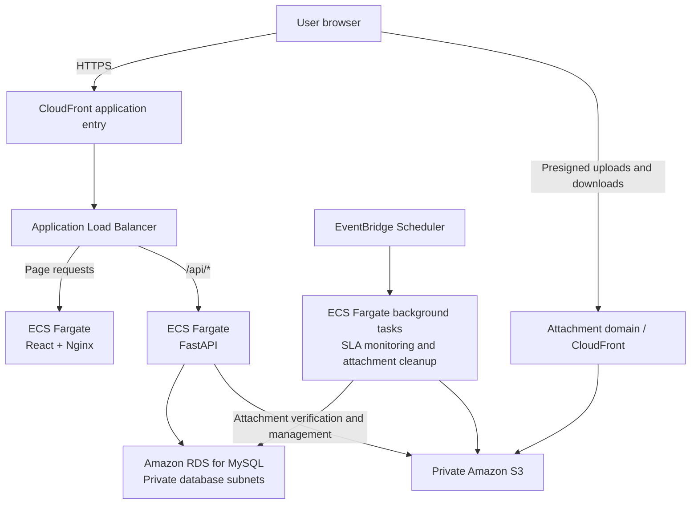

# INFS803 Group 8 — IT Service Desk

An IT service desk and incident ticketing system built on AWS, providing a shared platform for users, support engineers, external vendors and service desk managers to report and resolve IT issues.

Developed for the INFS803 Cloud Computing group assignment, the project combines a React frontend, FastAPI backend, MySQL database and managed AWS infrastructure. It supports the full ticket lifecycle, from submission and assignment through collaboration, resolution confirmation and closure.

## Team members

| Member | Name | Main responsibilities |
| --- | --- | --- |
| A | **BIN LIN** | Platform APIs, attachment management, dashboards, AWS infrastructure and deployment |
| B | **Yujuan Gao** | Authentication, user management, tickets, comments and database coordination |
| C | **Andy Wen** | Ticket assignment, workflows, SLA management, vendor collaboration, auditing and project coordination |
| D | **Yiguang Sun** | Frontend pages, user interactions, API integration and frontend testing |

## Purpose

Network, hardware, software and account issues often require several people to resolve. When requests are tracked through email or chat, ownership can become unclear, progress is difficult to follow and important details can be lost.

This system records each request as a ticket with an owner, status and service deadline. Users can follow progress, engineers can document their work, and managers can identify unassigned tickets and overdue work.

## Main features

| Feature | Description |
| --- | --- |
| Ticket management | Create, search and edit tickets, including category, priority, description and current status |
| Automatic assignment and manual allocation | Select eligible engineers using skills, availability and active workload; allow managers to assign or reassign tickets |
| Tiered support | Handle routine issues at Tier 1 and escalate complex cases to Tier 2 |
| Vendor collaboration | Let Tier 2 engineers request external assistance and read persisted vendor request and reply history |
| Comments and attachments | Share updates, screenshots, documents and logs with role-based visibility |
| SLA tracking | Track service deadlines, at-risk and overdue states, user-response windows and post-resolution deadlines |
| Management dashboards | Show ticket status counts, SLA risk, overdue work and items requiring manual intervention |
| Audit history | Record assignments, escalations, state transitions and collaboration events for traceability |

## User roles

| Role | Main responsibilities |
| --- | --- |
| User | Report issues, view their own tickets, provide information, confirm resolutions, and reopen or close tickets when permitted |
| Tier 1 engineer | Handle assigned tickets, request more information, propose resolutions and escalate complex issues |
| Tier 2 engineer | Handle escalated tickets, coordinate vendors and submit the final resolution to the user |
| External vendor | View requests within their organisation's authorized scope, submit replies and share attachments |
| Service desk manager | Monitor overall operations and manage unassigned, overdue and reassigned work |

Access checks consider the user's role, the ticket's visibility and its current state. External vendors can access only the collaboration information authorized for their organisation.

## Typical workflow

1. **Submit an issue.** The user provides a description, category and priority.
2. **Assign the ticket.** The system selects an eligible Tier 1 engineer. If none is available, the ticket enters the unassigned queue for a manager to handle.
3. **Investigate and respond.** The engineer records progress and requests additional information when needed.
4. **Escalate or collaborate.** Complex issues move to Tier 2, which can involve an external vendor.
5. **Propose a resolution.** The engineer explains the outcome, and the user confirms it or reports that the issue persists.
6. **Resolve and close.** A resolved ticket can be reopened or manually closed within the permitted window; it closes automatically when that window expires.

SLA tracking and audit events run throughout the workflow. Waiting for a user, collaborating with a vendor, reopening a ticket and handling timeouts each follow their own state and timing rules.

## Infrastructure architecture

The system separates the frontend, backend and database. Frontend and backend containers run as independent services on **Amazon ECS with AWS Fargate**, behind **CloudFront** and an **Application Load Balancer**. **Amazon RDS for MySQL** stores business data, while private **Amazon S3** storage holds attachments.

The diagram summarizes the components and connections defined by the repository's infrastructure and release configuration.



### Request handling and storage

- **CloudFront** provides the browser-facing HTTPS entry point, with separate cache policies for frontend content and API requests.
- **Application Load Balancer (ALB)** routes `/api/*` requests to the backend and other page requests to the frontend.
- **The frontend service** uses Nginx to serve the built React application and static assets. The browser communicates with the backend through its API.
- **The backend service** handles authentication, authorization, ticket workflows, SLA rules, attachment access and database operations.
- **Amazon RDS for MySQL** stores accounts, tickets, comments, vendor collaboration, attachment metadata and audit records. The database is not publicly accessible from the internet.
- **Amazon S3** stores attachment files. After backend authorization, the browser uses a short-lived presigned URL to upload or download a file. The backend verifies each completed upload before registering it as an attachment.

### Background tasks and supporting services

| Component | Purpose |
| --- | --- |
| EventBridge Scheduler | Starts separate SLA-monitoring and attachment-cleanup tasks according to the deployment configuration |
| AWS Secrets Manager | Stores database connection details and the JWT secret, which are injected when tasks start |
| IAM and security groups | Control access to AWS resources and network traffic between components |
| CloudWatch Logs | Collects logs from the frontend, backend and background tasks |
| Amazon ECR | Stores frontend and backend container images for release |
| Terraform | Defines networking, compute, database, permissions and scheduling infrastructure |

Background jobs run separately from the web services. The repository includes their schedule definitions; deployment settings determine whether they are enabled. Terraform disables schedules by default until initialization and verification are complete.

## Technology stack

| Layer | Technologies |
| --- | --- |
| Frontend | React, TypeScript, Vite, Ant Design, React Router, TanStack Query, Axios |
| Backend | Python, FastAPI, Uvicorn, SQLAlchemy, Pydantic |
| Database | MySQL 8.4 / Amazon RDS |
| Attachment storage | Amazon S3 |
| Containers and compute | Docker, Amazon ECS, AWS Fargate |
| Public entry point | Amazon CloudFront, Application Load Balancer |
| Build and release | GitHub Actions, Amazon ECR |
| Infrastructure management | Terraform |

## Build and deployment

The repository provides independent [frontend](.github/workflows/frontend.yml) and [backend](.github/workflows/backend.yml) GitHub Actions release workflows. Both are manually triggered from `main` through **Actions → Frontend / Backend - manual build and deploy → Run workflow**.

| Release mode | Behavior |
| --- | --- |
| `build-only` | Run the relevant checks, build and push an image, and leave the running service unchanged |
| `build-and-deploy` | Run checks, build an image and update the corresponding ECS service |
| `deploy-existing` | Deploy a specified existing image without rebuilding the application |

GitHub Actions uses OIDC to obtain temporary AWS credentials. Frontend and backend images share one immutable ECR repository, use different component-prefixed tags and are deployed to their respective ECS services.

Release scripts check service state and health, and attempt rollback if deployment fails. Frontend releases also invalidate the CloudFront cache. Ordinary pushes and pull requests do not automatically trigger deployment.

## Repository structure

```text
ITSM/
├── backend/               # FastAPI application, database schema, tests and scripts
│   └── contracts/         # OpenAPI contract used by the current implementation
├── frontend/              # React pages, generated API client and frontend tests
├── infrastructure/        # Terraform, deployment scripts, environment config and tests
├── docs/                  # Project baseline, API specification and database design
├── .github/               # GitHub Actions, contribution templates and code ownership
└── docker-compose.local.yml
```

## Local development

1. Configure `backend/.env` and `frontend/.env` using their `.env.example` files. Preserve any existing local settings.
2. Start MySQL from the repository root:

   ```powershell
   docker compose -f docker-compose.local.yml up -d mysql
   ```

   On the first start with an empty MySQL data volume, Compose applies `backend/database/schema.sql` to initialize the database.

3. In `backend/`, create a Python 3.12 virtual environment, activate it and install the dependencies:

   ```powershell
   py -3.12 -m venv .venv
   .\.venv\Scripts\Activate.ps1
   python -m pip install -r requirements-dev.txt
   uvicorn app.main:app --reload
   ```

4. In `frontend/`, use a supported Node version as documented in [frontend/README.md](frontend/README.md), then install dependencies and start the development server:

   ```powershell
   npm ci
   npm run dev
   ```

5. Open the [frontend](http://localhost:5173) and [backend API documentation](http://localhost:8000/api/docs).

During local development, Docker Compose runs MySQL only; the frontend and backend run directly on the developer's computer. The frontend example configuration enables Mocks by default. To connect to the real backend, set `VITE_USE_MOCKS=false`, check the API base URL and CORS configuration, and restart the development server.

Real attachment operations also require a configured private S3 bucket and appropriate AWS access. See [backend/README.md](backend/README.md) for attachment configuration and [frontend/README.md](frontend/README.md) for frontend development and test commands.

## Project documents and API contract

The `docs/` directory contains four process documents:

- [Unified project development baseline v6.0](docs/IT-Service-Desk-Unified-Project-Baseline-v6.0.md)
- [Final API development specification v1.1](docs/IT-Service-Desk-Final-API-Specification-v1.1.md)
- [Process OpenAPI v1.1](docs/IT-Service-Desk-OpenAPI-v1.1.yaml)
- [Final database design v1.1](docs/IT-Service-Desk-Database-Final-Design-v1.1.md)

These documents preserve the original 32-operation baseline. The current implementation adds the vendor request history endpoint, bringing the total to **33 operations**. Client generation and contract tests use [backend/contracts/openapi.yaml](backend/contracts/openapi.yaml); the corresponding [JSON contract](backend/contracts/openapi.json) is in the same directory.
