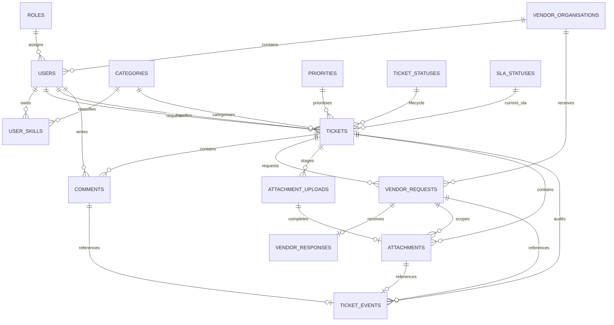

# IT Service Desk Final Database Design v1.1

> **Team member reference:** Throughout this document, A = BIN LIN; B = Yujuan Gao; C = Andy Wen; D = Yiguang Sun.

## 1. Document Purpose

This document defines the final MySQL database design for the IT Service Desk project. It provides a shared basis for Backend members A (BIN LIN), B (Yujuan Gao) and C (Andy Wen) to create SQLAlchemy models, implement repositories, run local integration tests and deploy to Amazon RDS.

This version adopts the following frozen decisions:

- Local development and AWS RDS use the same database name: `service_desk`.
- Every environment uses all 19 tables; members must no longer create only a subset of tables.
- A (BIN LIN), B (Yujuan Gao) and C (Andy Wen) each create a complete, isolated `service_desk` database in their own local MySQL instance.
- MySQL versions 8.0/8.4 are supported; the final target is Amazon RDS for MySQL 8.4.
- The character set is `utf8mb4`, the collation is `utf8mb4_0900_ai_ci`, and all timestamps are stored in UTC.
- All tables use InnoDB to support transactions, foreign keys and `SELECT ... FOR UPDATE`.
- Alembic is not used. `backend/database/schema.sql` is the sole executable schema contract; the same file is run against empty local and RDS databases.
- SQLAlchemy models are application mappings and must match the canonical SQL field by field. Do not use `Base.metadata.create_all()` to generate a separate schema.
- The accompanying canonical SQL is frozen from `IT-Service-Desk-MySQL-Schema-v1.0.sql`. Version 1.1 only corrects document precedence and initialisation rules; it does not change the DDL already validated on MySQL 8.4.

> This design replaces the distinction between the `service_desk_dev` and `service_desk_final` database names in earlier documents. Environments are isolated through separate MySQL instances/endpoints, credentials and S3 prefixes, rather than different database names. If field definitions or initialisation rules conflict, `IT-Service-Desk-Unified-Project-Baseline-v6.0.md` governs processes and ownership, the canonical SQL governs the executable schema, and this document explains fields and relationships.

### 1.1 Current Repository Locations

Checked on 2026-10-07 against GitHub `main` [`379bb53`](https://github.com/infs803-group8/ITSM/tree/379bb531504e78b2b293564b070f8af33b85449c). This design document is directly under `docs/`; the executable SQL and database support files are under `backend/`.

| Artifact | Current repository path |
|---|---|
| This design document | `docs/IT-Service-Desk-Database-Final-Design-v1.1.md` |
| Canonical SQL | [`backend/database/schema.sql`](../backend/database/schema.sql) |
| Shared database modules and model registry | `backend/app/db/`, `backend/app/db/model_registry.py` |
| Domain models | `backend/app/domains/` |
| Database verification tests | `backend/tests/database/` |
| MySQL integration tests and runner | `backend/tests/integration/`, `backend/scripts/run_mysql_integration.py` |
| Schema release evidence and reviewed patches | `backend/database/release/`, `backend/database/patches/` |
| Local MySQL service configuration | [`docker-compose.local.yml`](../docker-compose.local.yml) |

`IT-Service-Desk-MySQL-Schema-v1.0.sql` identifies the original source baseline; it is not a second SQL file required in the current repository. Use the tracked `backend/database/schema.sql`. File presence here does not assert that every bootstrap or verification entry point is fully implemented.

## 2. Design Objectives

The database must support the following business capabilities:

1. Five system roles, user login profiles, engineer availability and category-based skills.
2. Ticket creation, automatic assignment, manual assignment, Tier 2 escalation and role-aware queries.
3. A 48-hour Engineering SLA, an 80% AT_RISK threshold, OVERDUE status, a 120-hour user timer and a seven-day closure window.
4. Separation of ordinary comments from workflow comments.
5. Isolated collaboration between Tier 2 and external vendors, with at most one ACTIVE vendor request per ticket at any time.
6. AttachmentUpload sessions for direct browser uploads to private S3, and verified attachment metadata.
7. An append-only TicketEvent audit timeline filtered by role/organisation.
8. Indexes for dashboards, current/historical overdue records, ticket lists and background jobs.
9. Prevention of clearly invalid or conflicting data through foreign keys, unique keys, CHECK constraints and triggers.

## 3. Database Naming and Environment Usage

| Item | Standard Rule |
|---|---|
| Database Name | `service_desk` |
| Local Development | A (BIN LIN), B (Yujuan Gao) and C (Andy Wen) each create a complete `service_desk` database in their own MySQL instance. |
| AWS Integration/Final | Create a complete `service_desk` database in RDS with exactly the same schema as the local databases. |
| Character Set | `utf8mb4` |
| Collation | `utf8mb4_0900_ai_ci` |
| Timezone | UTC; set `time_zone='+00:00'` after establishing each application connection. |
| Engine | InnoDB |
| ID | Business primary keys use `BIGINT UNSIGNED AUTO_INCREMENT`; attachment UUIDs use ASCII `CHAR(36)`. |
| Deletion Policy | Business records are not physically deleted. Users, vendors and similar entities are deactivated through `is_active`. Foreign keys default to RESTRICT. |
| Secret | JWT secrets, AWS keys and database passwords must not be stored in business tables or Git. |

Correct usage during development:

```text
Member A (BIN LIN)'s local MySQL instance ── service_desk (all 19 tables)
Member B (Yujuan Gao)'s local MySQL instance ── service_desk (all 19 tables)
Member C (Andy Wen)'s local MySQL instance ── service_desk (all 19 tables)
AWS RDS instance               ── service_desk (the same 19 tables)
```

Each member may develop only their own domain, but must not create only their own tables: foreign keys, API integration tests, workflow transactions and the OpenAPI contract all depend on the complete schema.

## 4. Logical Relationship Diagram



## 5. Table Inventory and Ownership

| # | Table | Owner/Coordinator | Purpose |
|---:|---|---|---|
| 1 | `schema_metadata` | B (Yujuan Gao) | Records the installed schema version. |
| 2 | `roles` | B (Yujuan Gao) | The five system roles. |
| 3 | `categories` | B (Yujuan Gao) | Ticket categories, also used as engineer skill categories. |
| 4 | `priorities` | B (Yujuan Gao) | Ticket Priority. |
| 5 | `ticket_statuses` | B (Yujuan Gao)/C (Andy Wen) Review | Ticket lifecycle states. |
| 6 | `sla_statuses` | C (Andy Wen) | Current Engineering SLA status. |
| 7 | `service_config` | B (Yujuan Gao) coordinates; A (BIN LIN)/C (Andy Wen) review | SLA, timer and attachment limits. |
| 8 | `allowed_attachment_types` | A (BIN LIN) | Allowed extension/MIME combinations. |
| 9 | `vendor_organisations` | B (Yujuan Gao) | External Vendor Organisation Directory. |
| 10 | `users` | B (Yujuan Gao) | All login accounts, including role, availability and vendor binding. |
| 11 | `user_skills` | B (Yujuan Gao)/C (Andy Wen) Review | Many-to-many skill relationships between engineers and categories. |
| 12 | `assignment_control` | C (Andy Wen) | Singleton lock row for initial automatic assignment. |
| 13 | `tickets` | B (Yujuan Gao) maintains the model; C (Andy Wen) defines the workflow | Ticket core data and the current workflow/SLA snapshot. |
| 14 | `comments` | B (Yujuan Gao) | Ordinary and workflow comments. |
| 15 | `vendor_requests` | C (Andy Wen) | Sanitised requests sent from Tier 2 to vendors. |
| 16 | `vendor_responses` | C (Andy Wen) | Formal vendor responses. |
| 17 | `attachment_uploads` | A (BIN LIN) | Upload sessions between Presign and Complete. |
| 18 | `attachments` | A (BIN LIN) | Metadata for verified S3 objects. |
| 19 | `ticket_events` | C (Andy Wen) | Append-only audit timeline and SLA history. |

## 6. Complete Field Dictionary

In the field tables, PK, FK, UQ and IDX mean primary key, foreign key, unique key and ordinary index, respectively. `NULL=Yes` means that the field may have no value in a valid business state.

### 6.1 `schema_metadata`

Purpose: identify the installed logical database name and schema version. Only one row, with `schema_id=1`, is allowed.

| Field | MySQL Type | NULL | Default/Key | Description |
|---|---|---:|---|---|
| `schema_id` | `TINYINT UNSIGNED` | No | PK, Default 1 | Singleton ID; a CHECK constraint requires it to equal 1. |
| `schema_name` | `VARCHAR(100)` | No |  | Logical system name. |
| `schema_version` | `VARCHAR(20)` | No |  | Current frozen schema version, e.g. `1.0`. |
| `installed_at` | `DATETIME(6)` | No | Current UTC | Initial installation time. |
| `updated_at` | `DATETIME(6)` | No | Auto update | Last update time of the schema version record. |

### 6.2 `roles`

Purpose: store the five roles corresponding to the API `Role` enum, referenced by `users.role_code`.

| Field | MySQL Type | NULL | Default/Key | Description |
|---|---|---:|---|---|
| `role_code` | `VARCHAR(32)` | No | PK | `USER`, `ENGINEER_TIER1`, `ENGINEER_TIER2`, `EXTERNAL_VENDOR`, `SERVICE_DESK_MANAGER`. |
| `display_name` | `VARCHAR(100)` | No |  | Name displayed in the UI. |
| `description` | `VARCHAR(500)` | Yes |  | Role description. |
| `is_active` | `TINYINT(1)` | No | Default 1 | Whether the role remains available for use. |
| `created_at` | `DATETIME(6)` | No | Current UTC | Creation time. |

### 6.3 `categories`

Purpose: use one stable set of codes for ticket categories and engineer skills.

| Field | MySQL Type | NULL | Default/Key | Description |
|---|---|---:|---|---|
| `category_code` | `VARCHAR(32)` | No | PK | `NETWORK`, `HARDWARE`, `SOFTWARE`, `ACCOUNT`, `OTHER`. |
| `display_name` | `VARCHAR(100)` | No |  | Name displayed in the UI. |
| `description` | `VARCHAR(500)` | Yes |  | Category description. |
| `sort_order` | `SMALLINT UNSIGNED` | No | Default 0 | Sort order for API-12 and dropdown lists. |
| `is_active` | `TINYINT(1)` | No | Default 1 | Whether new tickets/skills may use this category. |
| `created_at` | `DATETIME(6)` | No | Current UTC | Creation time. |

### 6.4 `priorities`

Purpose: store ticket priority reference data.

| Field | MySQL Type | NULL | Default/Key | Description |
|---|---|---:|---|---|
| `priority_code` | `VARCHAR(16)` | No | PK | `LOW`, `MEDIUM`, `HIGH`, `URGENT`. |
| `display_name` | `VARCHAR(100)` | No |  | Name displayed in the UI. |
| `description` | `VARCHAR(500)` | Yes |  | Description of the business impact. |
| `sort_order` | `SMALLINT UNSIGNED` | No | Default 0 | Display order. |
| `is_active` | `TINYINT(1)` | No | Default 1 | Whether this option can be selected. |
| `created_at` | `DATETIME(6)` | No | Current UTC | Creation time. |

### 6.5 `ticket_statuses`

Purpose: store internal ticket lifecycle states. `NEW` exists only briefly within the API-15 creation transaction and is not returned to the frontend.

| Field | MySQL Type | NULL | Default/Key | Description |
|---|---|---:|---|---|
| `status_code` | `VARCHAR(32)` | No | PK | NEW, UNASSIGNED, ASSIGNED, IN_PROGRESS, PENDING_USER, PENDING_VENDOR, RESOLVED, REOPENED, CLOSED. |
| `display_name` | `VARCHAR(100)` | No |  | Internal display name. |
| `description` | `VARCHAR(500)` | Yes |  | Status description. |
| `sort_order` | `SMALLINT UNSIGNED` | No | Default 0 | Display order. |
| `is_api_visible` | `TINYINT(1)` | No | Default 1 | `NEW=0`; all other states use 1. Role-aware serializers may further hide PENDING_VENDOR. |

### 6.6 `sla_statuses`

Purpose: represent the current Engineering SLA cycle status, rather than the ticket lifecycle state.

| Field | MySQL Type | NULL | Default/Key | Description |
|---|---|---:|---|---|
| `sla_status_code` | `VARCHAR(16)` | No | PK | ON_TRACK, AT_RISK, OVERDUE, PAUSED, MET. |
| `display_name` | `VARCHAR(100)` | No |  | Name displayed in the UI. |
| `description` | `VARCHAR(500)` | Yes |  | Explanation of the status. |
| `sort_order` | `SMALLINT UNSIGNED` | No | Default 0 | Display order. |

### 6.7 `service_config`

Purpose: store the shared timer/attachment limits used by API-12, workflow services and scheduled tasks. Only one row, with `config_id=1`, is allowed.

| Field | MySQL Type | NULL | Default/Key | Description |
|---|---|---:|---|---|
| `config_id` | `TINYINT UNSIGNED` | No | PK, Default 1 | Singleton ID. |
| `engineering_sla_hours` | `SMALLINT UNSIGNED` | No | Default 48 | Number of hours in each engineering cycle. |
| `at_risk_percent` | `TINYINT UNSIGNED` | No | Default 80 | Percentage of the cycle elapsed when the AT_RISK event is recorded. |
| `user_response_hours` | `SMALLINT UNSIGNED` | No | Default 120 | Response window for INFORMATION_REQUIRED and RESOLUTION_CONFIRMATION. |
| `resolved_window_hours` | `SMALLINT UNSIGNED` | No | Default 168 | Seven-day window after RESOLVED during which Reopen/Manual Close is allowed. |
| `attachment_max_size_bytes` | `BIGINT UNSIGNED` | No | Default 10485760 | Maximum file size: 10 MiB. |
| `upload_url_ttl_seconds` | `INT UNSIGNED` | No | Default 900 | Presigned PUT validity: 15 minutes. |
| `download_url_ttl_seconds` | `INT UNSIGNED` | No | Default 300 | Presigned GET validity: 5 minutes. |
| `sla_monitor_interval_minutes` | `SMALLINT UNSIGNED` | No | Default 5 | Recommended SLA monitor interval. |
| `attachment_cleanup_interval_minutes` | `SMALLINT UNSIGNED` | No | Default 30 | Recommended upload session cleanup interval. |
| `updated_at` | `DATETIME(6)` | No | Auto update | Last configuration update time. |

### 6.8 `allowed_attachment_types`

Purpose: define the extension/MIME combinations allowed by API-02 and returned by API-12.

| Field | MySQL Type | NULL | Default/Key | Description |
|---|---|---:|---|---|
| `extension` | `VARCHAR(16)` | No | PK | Lowercase, without a leading dot, e.g. `png`, `log`. |
| `content_type` | `VARCHAR(100)` ASCII | No | IDX | Required MIME type, e.g. `image/png`. |
| `description` | `VARCHAR(200)` | Yes |  | File type description. |
| `is_active` | `TINYINT(1)` | No | Default 1 | Whether new uploads are allowed. |
| `created_at` | `DATETIME(6)` | No | Current UTC | Creation time. |

### 6.9 `vendor_organisations`

Purpose: provide the API-14 vendor directory and the organisational boundary for vendor scope.

| Field | MySQL Type | NULL | Default/Key | Description |
|---|---|---:|---|---|
| `vendor_org_id` | `BIGINT UNSIGNED` | No | PK, Auto Increment | Vendor organisation ID. |
| `name` | `VARCHAR(200)` | No | UQ | Organisation name. |
| `is_active` | `TINYINT(1)` | No | Default 1, IDX | Only active organisations may receive new requests. |
| `created_at` | `DATETIME(6)` | No | Current UTC | Creation time. |
| `updated_at` | `DATETIME(6)` | No | Auto update | Last update time. |

### 6.10 `users`

Purpose: store login accounts for all requesters, Tier 1 engineers, Tier 2 engineers, managers and vendors.

| Field | MySQL Type | NULL | Default/Key | Description |
|---|---|---:|---|---|
| `user_id` | `BIGINT UNSIGNED` | No | PK, Auto Increment | User ID. |
| `email` | `VARCHAR(254)` | No | UQ | Normalised lowercase login email. |
| `password_hash` | `VARCHAR(255)` ASCII | No |  | Strong hash such as Argon2/bcrypt; never returned by an API. |
| `display_name` | `VARCHAR(100)` | No |  | Safe display name. |
| `role_code` | `VARCHAR(32)` | No | FK → roles, IDX | Current authorised role. |
| `is_available` | `TINYINT(1)` | Yes | IDX | Must be 0/1 for Tier 1/Tier 2; must be NULL for other roles. |
| `vendor_org_id` | `BIGINT UNSIGNED` | Yes | FK → vendor_organisations, IDX | Vendors must be bound to an organisation; must be NULL for other roles. |
| `is_active` | `TINYINT(1)` | No | Default 1, IDX | Deactivates an account without physically deleting the historical actor. |
| `last_assigned_at` | `DATETIME(6)` | Yes | IDX | Stable ordering field for initial automatic assignment. |
| `created_at` | `DATETIME(6)` | No | Current UTC | Account creation time. |
| `updated_at` | `DATETIME(6)` | No | Auto update | Last profile update time. |

Key constraints: engineers must have `is_available`; vendors must have `vendor_org_id`; email must be stored as `LOWER(TRIM(email))`.

### 6.11 `user_skills`

Purpose: record the categories each engineer can handle. Both initial assignment and API-13 use this table.

| Field | MySQL Type | NULL | Default/Key | Description |
|---|---|---:|---|---|
| `user_id` | `BIGINT UNSIGNED` | No | PK, FK → users | Engineer user ID. |
| `category_code` | `VARCHAR(32)` | No | PK, FK → categories, IDX | Engineer skill category. |
| `created_at` | `DATETIME(6)` | No | Current UTC | Skill relationship creation time. |

The composite PK `(user_id, category_code)` prevents duplicate skills. The service must also validate that the user's role is Tier 1/Tier 2.

### 6.12 `assignment_control`

Purpose: provide the singleton row locked using `SELECT ... FOR UPDATE` during API-15 initial automatic assignment, so concurrent ticket creations calculate active load sequentially.

| Field | MySQL Type | NULL | Default/Key | Description |
|---|---|---:|---|---|
| `control_id` | `TINYINT UNSIGNED` | No | PK, Default 1 | Singleton ID; must equal 1. |
| `control_name` | `VARCHAR(50)` | No | UQ | Fixed as `INITIAL_ASSIGNMENT`. |
| `updated_at` | `DATETIME(6)` | No | Auto update | Last update time of the lock row; no business state is stored here. |

### 6.13 `tickets`

Purpose: store ticket core data and the current workflow/SLA snapshot. Historical cycles, assignments, resolutions and closure evidence are stored in `ticket_events`.

| Field | MySQL Type | NULL | Default/Key | Description |
|---|---|---:|---|---|
| `ticket_id` | `BIGINT UNSIGNED` | No | PK, Auto Increment | Ticket ID. |
| `requester_id` | `BIGINT UNSIGNED` | No | FK → users, IDX | The USER who created the ticket. |
| `title` | `VARCHAR(200)` | No |  | Title, 1–200 characters. |
| `description` | `TEXT` | No |  | Original user description, 1–5000 characters; not returned directly to vendors. |
| `category_code` | `VARCHAR(32)` | No | FK → categories, IDX | Ticket category. |
| `priority_code` | `VARCHAR(16)` | No | FK → priorities, IDX | Ticket priority. |
| `status_code` | `VARCHAR(32)` | No | FK → ticket_statuses, Default NEW, IDX | Internal lifecycle state. |
| `assignee_id` | `BIGINT UNSIGNED` | Yes | FK → users, IDX | Current Tier 1/Tier 2 assignee. |
| `last_resolved_assignee_id` | `BIGINT UNSIGNED` | Yes | FK → users | Assignee saved on entering RESOLVED, given preference when restoring assignment on Reopen. |
| `sla_cycle_no` | `INT UNSIGNED` | No | Default 1 | Current engineering cycle number. |
| `sla_status_code` | `VARCHAR(16)` | No | FK → sla_statuses, Default ON_TRACK, IDX | Current SLA status. |
| `sla_started_at` | `DATETIME(6)` | Yes |  | Current cycle start time. |
| `sla_deadline` | `DATETIME(6)` | Yes | IDX | Current cycle deadline. |
| `pending_user_reason` | `VARCHAR(32)` | Yes |  | INFORMATION_REQUIRED or RESOLUTION_CONFIRMATION. |
| `pending_user_deadline` | `DATETIME(6)` | Yes | IDX | Deadline for the user's 120-hour response window. |
| `resolution_summary` | `TEXT` | Yes |  | User-visible resolution submitted by the engineer, up to 5000 characters. |
| `resolution_type` | `VARCHAR(64)` | Yes |  | USER_CONFIRMED, AUTO_NO_USER_RESPONSE, AUTO_CONFIRMATION_TIMEOUT. |
| `resolved_at` | `DATETIME(6)` | Yes |  | Time the ticket formally entered RESOLVED. |
| `auto_close_at` | `DATETIME(6)` | Yes | IDX | `resolved_at + 168h`. |
| `closure_type` | `VARCHAR(32)` | Yes |  | MANUAL_USER or AUTO_AFTER_7_DAYS. |
| `closed_at` | `DATETIME(6)` | Yes |  | Time the ticket entered CLOSED. |
| `created_at` | `DATETIME(6)` | No | Current UTC, IDX | Ticket creation time. |
| `updated_at` | `DATETIME(6)` | No | Auto update | Last business update time. |

Key CHECK constraints:

- UNASSIGNED requires `assignee_id=NULL`; ASSIGNED/IN_PROGRESS/PENDING_USER/PENDING_VENDOR require an assignee.
- Only PENDING_USER may store `pending_user_reason/deadline`.
- RESOLUTION_CONFIRMATION requires `resolution_summary`, but `resolution_type/resolved_at` must not yet be set.
- RESOLVED/CLOSED require a resolution type, resolution time and automatic closure time.
- CLOSED requires a closure type and closure time; closure fields are not allowed for any other state.

### 6.14 `comments`

Purpose: store ordinary communication and formal communication created by workflow services such as API-23/API-24.

| Field | MySQL Type | NULL | Default/Key | Description |
|---|---|---:|---|---|
| `comment_id` | `BIGINT UNSIGNED` | No | PK, Auto Increment | Comment ID. |
| `ticket_id` | `BIGINT UNSIGNED` | No | FK → tickets, IDX | Parent ticket. |
| `author_id` | `BIGINT UNSIGNED` | No | FK → users, IDX | Comment author. |
| `message` | `TEXT` | No |  | Content, 1–4000 characters. |
| `visibility` | `VARCHAR(32)` | No |  | USER_VISIBLE or INTERNAL_ONLY. |
| `comment_type` | `VARCHAR(16)` | No | Default ORDINARY | ORDINARY or WORKFLOW. |
| `workflow_action` | `VARCHAR(64)` | Yes |  | Stable action name for WORKFLOW; must be NULL for ORDINARY. |
| `created_at` | `DATETIME(6)` | No | Current UTC, IDX | Creation time. |

Note: a comment does not automatically change ticket state. The workflow service must create the comment, update the ticket and record the event in the same transaction.

### 6.15 `vendor_requests`

Purpose: store vendor-safe requests explicitly written by Tier 2, without automatically copying user descriptions, personal data or internal comments.

| Field | MySQL Type | NULL | Default/Key | Description |
|---|---|---:|---|---|
| `vendor_request_id` | `BIGINT UNSIGNED` | No | PK, Auto Increment | Vendor request ID. |
| `ticket_id` | `BIGINT UNSIGNED` | No | FK → tickets, IDX | Parent ticket. |
| `vendor_org_id` | `BIGINT UNSIGNED` | No | FK → vendor_organisations, IDX | Organisation receiving the request. |
| `requested_by_id` | `BIGINT UNSIGNED` | No | FK → users | Tier 2 engineer who created the request. |
| `vendor_message` | `TEXT` | No |  | Sanitised message, 1–4000 characters. |
| `status` | `VARCHAR(16)` | No | Default ACTIVE, IDX | ACTIVE, RESPONDED, CANCELLED. |
| `responded_at` | `DATETIME(6)` | Yes |  | Time of the formal vendor response. |
| `cancelled_at` | `DATETIME(6)` | Yes |  | Cancellation time when Tier 2 resolves the ticket without waiting for the vendor. |
| `cancelled_by_id` | `BIGINT UNSIGNED` | Yes | FK → users | Tier 2 engineer who cancelled the request. |
| `cancellation_reason` | `VARCHAR(1000)` | Yes |  | Reason for cancellation. |
| `created_at` | `DATETIME(6)` | No | Current UTC, IDX | Creation time. |
| `updated_at` | `DATETIME(6)` | No | Auto update | Last status update time. |
| `active_ticket_guard` | Generated `BIGINT` | Yes | UQ | Equals ticket_id when ACTIVE, otherwise NULL; ensures at most one ACTIVE request per ticket at any time. |

### 6.16 `vendor_responses`

Purpose: store the single formal response submitted by a vendor to the current active request.

| Field | MySQL Type | NULL | Default/Key | Description |
|---|---|---:|---|---|
| `vendor_response_id` | `BIGINT UNSIGNED` | No | PK, Auto Increment | Vendor response ID. |
| `vendor_request_id` | `BIGINT UNSIGNED` | No | FK → vendor_requests, UQ | At most one formal response per request. |
| `responder_id` | `BIGINT UNSIGNED` | No | FK → users, IDX | Vendor user who submitted the response. |
| `message` | `TEXT` | No |  | Response content, 1–4000 characters. |
| `created_at` | `DATETIME(6)` | No | Current UTC | Response time. |

The service must still validate `responder.vendor_org_id = vendor_request.vendor_org_id`, because ordinary foreign keys cannot enforce cross-table role and organisation consistency.

### 6.17 `attachment_uploads`

Purpose: store a trusted upload session between API-02 Presign and API-03 Complete. A successful browser PUT does not mean the attachment has been formally registered.

| Field | MySQL Type | NULL | Default/Key | Description |
|---|---|---:|---|---|
| `upload_id` | ASCII `CHAR(36)` | No | PK | Backend-generated UUID; the sole input to API-03. |
| `ticket_id` | `BIGINT UNSIGNED` | No | FK → tickets, IDX | Fixed binding to the ticket. |
| `creator_id` | `BIGINT UNSIGNED` | No | FK → users, IDX | Actor who initiated Presign; only this actor may call Complete. |
| `object_key` | ASCII `VARCHAR(1024)` | No | UQ | Backend-generated private S3 object key. |
| `file_name` | `VARCHAR(255)` | No |  | Original display filename. |
| `expected_content_type` | ASCII `VARCHAR(100)` | No |  | MIME type validated by API-02. |
| `expected_size` | `BIGINT UNSIGNED` | No |  | File size validated by API-02, 1–10 MiB. |
| `visibility` | `VARCHAR(32)` | No |  | USER_VISIBLE, INTERNAL_ONLY, VENDOR_SHARED. |
| `vendor_request_id` | `BIGINT UNSIGNED` | Yes | FK → vendor_requests, IDX | VENDOR_SHARED must be bound to the current active request. |
| `vendor_org_id` | `BIGINT UNSIGNED` | Yes | FK → vendor_organisations, IDX | Organisation scope for VENDOR_SHARED. |
| `status` | `VARCHAR(16)` | No | Default PENDING, IDX | PENDING, COMPLETED, EXPIRED, ABORTED. |
| `expires_at` | `DATETIME(6)` | No | IDX | Presigned PUT expiry time. |
| `completed_at` | `DATETIME(6)` | Yes |  | Time Complete succeeded. |
| `expired_at` | `DATETIME(6)` | Yes |  | Time cleanup marked the session EXPIRED. |
| `aborted_at` | `DATETIME(6)` | Yes |  | Time the session was aborted following an integrity mismatch or ticket closure. |
| `attachment_id` | ASCII `CHAR(36)` | Yes | UQ, FK → attachments | Links the formal attachment after COMPLETED. |
| `created_at` | `DATETIME(6)` | No | Current UTC | Session creation time. |
| `updated_at` | `DATETIME(6)` | No | Auto update | Last status update time. |

Key constraints: VENDOR_SHARED requires both a vendor request and an organisation; both must be NULL for other visibility values. Only COMPLETED may have `attachment_id/completed_at`.

### 6.18 `attachments`

Purpose: store permanent metadata verified through S3 HeadObject; file bytes are stored only in private S3.

| Field | MySQL Type | NULL | Default/Key | Description |
|---|---|---:|---|---|
| `attachment_id` | ASCII `CHAR(36)` | No | PK | Attachment UUID. |
| `upload_id` | ASCII `CHAR(36)` | No | FK → attachment_uploads, UQ | Each upload session may produce at most one attachment. |
| `ticket_id` | `BIGINT UNSIGNED` | No | FK → tickets, IDX | Parent ticket. |
| `creator_id` | `BIGINT UNSIGNED` | No | FK → users | Uploader. |
| `object_key` | ASCII `VARCHAR(1024)` | No | UQ | Private S3 object key; not returned by the API. |
| `file_name` | `VARCHAR(255)` | No |  | Filename visible to the user. |
| `verified_content_type` | ASCII `VARCHAR(100)` | No |  | MIME type from HeadObject. |
| `verified_size` | `BIGINT UNSIGNED` | No |  | Size from HeadObject, 1–10 MiB. |
| `visibility` | `VARCHAR(32)` | No | IDX | USER_VISIBLE, INTERNAL_ONLY, VENDOR_SHARED. |
| `vendor_request_id` | `BIGINT UNSIGNED` | Yes | FK → vendor_requests, IDX | Historical scope for VENDOR_SHARED. |
| `vendor_org_id` | `BIGINT UNSIGNED` | Yes | FK → vendor_organisations, IDX | Vendor organisation scope. |
| `created_at` | `DATETIME(6)` | No | Current UTC, IDX | Formal registration time. |

`attachment_uploads.attachment_id` and `attachments.upload_id` form a bidirectional one-to-one relationship. API-03 must create the attachment, update the session and record the event in the same transaction.

### 6.19 `ticket_events`

Purpose: store an append-only audit timeline from ticket creation to closure, supporting API-07 history, API-32, SLA evidence and idempotency for concurrent jobs.

| Field | MySQL Type | NULL | Default/Key | Description |
|---|---|---:|---|---|
| `event_id` | `BIGINT UNSIGNED` | No | PK, Auto Increment | Event ID. |
| `ticket_id` | `BIGINT UNSIGNED` | No | FK → tickets, IDX | Parent ticket. |
| `event_type` | `VARCHAR(64)` | No | IDX, CHECK | Stable EventType, with 24 possible values. |
| `scope` | `VARCHAR(32)` | No | IDX | USER_VISIBLE, INTERNAL_ONLY, VENDOR_SCOPE. |
| `actor_id` | `BIGINT UNSIGNED` | Yes | FK → users | Acting user; NULL for system events. |
| `vendor_org_id` | `BIGINT UNSIGNED` | Yes | FK → vendor_organisations, IDX | VENDOR_SCOPE must be bound to an organisation. |
| `cycle_no` | `INT UNSIGNED` | Yes |  | Corresponding engineering cycle. |
| `comment_id` | `BIGINT UNSIGNED` | Yes | FK → comments, UQ | COMMENT_ADDED references the comment without copying its body. |
| `attachment_id` | ASCII `CHAR(36)` | Yes | FK → attachments, UQ | ATTACHMENT_ADDED references the attachment. |
| `vendor_request_id` | `BIGINT UNSIGNED` | Yes | FK → vendor_requests, IDX | Request reference for a vendor workflow event. |
| `metadata` | `JSON` | No | Default `{}` | Minimal non-sensitive metadata; must not copy complete comments, vendor payloads or secrets. |
| `occurred_at` | `DATETIME(6)` | No | Current UTC, IDX | Event occurrence time. |
| `cycle_guard_ticket_id` | Generated `BIGINT` | Yes | Part of UQ | Generates ticket_id only for cycle guard events. |
| `cycle_guard_cycle_no` | Generated `INT` | Yes | Part of UQ | Generates cycle_no only for cycle guard events. |
| `cycle_guard_event_type` | Generated `VARCHAR(64)` | Yes | Part of UQ | Generates an event type only for SLA_CYCLE_STARTED/PAUSED/AT_RISK/OVERDUE/MET. |

The generated guard's unique key `(ticket_id, cycle_no, event_type)` prevents reruns of the SLA job from writing the same SLA event type more than once for a cycle. Two triggers prohibit UPDATE and DELETE, keeping events append-only.

## 7. Key Relationships and Deletion Policy

| Parent | Child | Relationship | Deletion Policy/Reason |
|---|---|---|---|
| roles | users | 1:N | RESTRICT; roles referenced by historical accounts cannot be deleted. |
| vendor_organisations | users/vendor_requests/attachments/events | 1:N | RESTRICT; deactivate through `is_active=0`. |
| users | tickets/comments/vendor/attachments/events | 1:N | RESTRICT; deactivate accounts instead of physically deleting them, preserving audit actors. |
| tickets | comments/vendor_requests/uploads/attachments/events | 1:N | RESTRICT; tickets are not physically deleted. |
| vendor_requests | vendor_responses | 1:0..1 | Unique `vendor_request_id`. |
| vendor_requests | attachment_uploads/attachments/events | 1:N | Preserve historical vendor scope. |
| attachment_uploads | attachments | 1:0..1 | Bidirectional unique references support API-03 idempotency. |
| comments | ticket_events | 1:0..1 | COMMENT_ADDED events reference only `comment_id`. |
| attachments | ticket_events | 1:0..1 | ATTACHMENT_ADDED events reference only `attachment_id`. |

## 8. Rules That Cannot Rely Solely on Database Constraints

The following rules involve multiple tables, the authenticated actor, time boundaries or the state machine. Backend services/policies must enforce them within a transaction after locking the relevant rows:

1. The requester must have `role_code=USER`.
2. The assignee must be an active, available Tier 1/Tier 2 engineer with matching skills.
3. `user_skills` may be assigned only to engineers.
4. Initial assignment must lock the `assignment_control` row before calculating active load.
5. Manager Assign/Reassign must follow the state matrix; the assignee cannot be changed in arbitrary states.
6. The vendor response actor's `vendor_org_id` must match the active vendor request.
7. VENDOR_SHARED attachments must be bound to the current active vendor request; historical requests permit reads only, with no new additions.
8. API-03 must verify Size/Content-Type using S3 HeadObject and verify that the Complete actor is the Presign creator.
9. When `now >= deadline`, apply the automatic outcome before rejecting the expired user action.
10. Ordinary comments must not trigger Resume, Confirm Resolution or Vendor Response.
11. CLOSED prohibits all business writes, but previously authorised data remains readable.
12. TicketEvent, business objects and state changes must commit in the same transaction.

## 9. Index Design and Main Queries

| Use Case/API | Main Indexes |
|---|---|
| API-13 Initial Assignment Candidate | `users(role_code,is_active,is_available,last_assigned_at,user_id)`, `user_skills(category_code,user_id)` |
| API-16 Requester My Tickets | `tickets(requester_id,created_at,ticket_id)` |
| API-16 Engineer Queue | `tickets(assignee_id,status_code,sla_status_code,sla_deadline,ticket_id)` |
| API-16 Manager Filters | `tickets(status_code,category_code,priority_code,created_at,ticket_id)` |
| API-06 Dashboard / SLA Job | `tickets(sla_status_code,sla_deadline,status_code,ticket_id)` |
| Pending User Auto Result | `tickets(status_code,pending_user_deadline,ticket_id)` |
| Seven-day Auto Close | `tickets(status_code,auto_close_at,ticket_id)` |
| Vendor Ticket Scope | `vendor_requests(vendor_org_id,status,created_at,vendor_request_id)` |
| Upload Cleanup | `attachment_uploads(status,expires_at,upload_id)` |
| Attachment List | `attachments(ticket_id,visibility,created_at,attachment_id)` |
| API-32 Timeline | `ticket_events(ticket_id,scope,occurred_at,event_id)` |
| API-07 Overdue History | `ticket_events(event_type,occurred_at,event_id)` |

No full-text indexes are created for `description`, comment messages or vendor messages. For the MVP, `search` is initially limited to ticket ID/title or controlled queries, avoiding premature search complexity and additional resource requirements for an inexperienced team.

## 10. Database Mapping to the 32 APIs

| API | Main Tables Read | Main Tables Written |
|---:|---|---|
| 01 | schema_metadata or `SELECT 1` | None |
| 02 | tickets, vendor_requests, service_config, allowed_attachment_types | attachment_uploads |
| 03 | tickets, attachment_uploads | attachments, attachment_uploads, ticket_events |
| 04–05 | tickets, attachments, vendor_requests | None |
| 06 | tickets, users | None |
| 07 | tickets, ticket_events, users | None |
| 08 | roles | users |
| 09 | users | None |
| 10–11 | users, vendor_organisations | users (API-11 only) |
| 12 | categories, priorities, ticket_statuses, service_config, allowed_attachment_types | None |
| 13 | users, user_skills, categories, tickets | None |
| 14 | vendor_organisations | None |
| 15 | assignment_control, users, user_skills, tickets | tickets, users, ticket_events |
| 16–18 | tickets, users, user_skills | tickets (API-18 only), ticket_events (API-18 audit) |
| 19–20 | tickets, comments, users | comments, ticket_events (API-20 only) |
| 21–25 | tickets, users, user_skills, comments | tickets, comments (23/24), ticket_events |
| 26 | tickets, vendor_organisations, vendor_requests | tickets, vendor_requests, ticket_events |
| 27 | tickets, vendor_requests, users | tickets, vendor_requests, vendor_responses, ticket_events |
| 28–31 | tickets, vendor_requests | tickets, vendor_requests (when cancellation is required), ticket_events |
| 32 | tickets, ticket_events, users | None |

## 11. Transactions and Lock Order

To reduce deadlocks, all writes follow the same order:

```text
BEGIN
  1. SELECT Ticket ... FOR UPDATE
  2. Lock VendorRequest or AttachmentUpload next, if required
  3. Revalidate actor, scope, status, deadline and binding
  4. Update business objects
  5. INSERT TicketEvent
COMMIT
```

API-15 initial assignment follows this order:

```text
BEGIN
  1. SELECT assignment_control WHERE control_id=1 FOR UPDATE
  2. Calculate eligible Tier 1 candidates and active load
  3. INSERT/UPDATE the ticket and the assignee's last_assigned_at
  4. INSERT TicketEvent
COMMIT
```

Failed requests roll back in full; no failure event is recorded.

## 12. Initialisation, Verification and Collaboration

### 12.1 Local Development

1. Each Backend member installs MySQL 8.0/8.4 and uses their own local account.
2. Use the canonical SQL already tracked at `backend/database/schema.sql`. Run this reviewed file on an empty instance to create the complete `service_desk` database; do not replace it with a separately maintained copy of the original source SQL.
3. The Backend `.env` stores only the member's own connection string and must not be committed to Git.
4. A (BIN LIN)/B (Yujuan Gao)/C (Andy Wen) use the same SQLAlchemy model registry and must not import only their own domain models. CI schema drift tests must compare the models against the canonical SQL.
5. When changing the schema, the domain owner first updates the model and this design; B (Yujuan Gao) reviews foreign keys, indexes and empty-database creation results.
6. During feature development, members may rebuild their own empty local databases, but must not merge personal SQL dumps into the final schema.

### 12.2 AWS RDS

1. Create an empty, private RDS MySQL 8.4 instance.
2. Use a one-off bootstrap task to create the same `service_desk` database and complete schema in RDS.
3. Run the non-sensitive reference seed; do not run the demo user seed.
4. Verify the schema: table count, foreign keys, unique keys, indexes, CHECK constraints and triggers.
5. Begin frontend cloud integration only after the backend smoke test passes.

### 12.3 Expected Verification Results

- 19 base tables, all using InnoDB.
- 35 foreign keys.
- Key unique guards cover email, vendor name, user skills, one active vendor request, one vendor response, upload/object/attachment and SLA cycle events.
- `ticket_events` has two triggers that prohibit UPDATE/DELETE.
- The database contains no demo accounts, plaintext passwords, AWS credentials or JWT secrets.

## 13. Canonical SQL and SQLAlchemy Model Alignment

The canonical SQL is the sole source of the executable schema; this document explains fields, and SQLAlchemy models map the backend to that schema. Backend models must match the SQL exactly:

- Column names, types, nullability and defaults must match.
- Relationships must not delete historical records through ORM cascades.
- Enum/reference codes must match the API's OpenAPI enums.
- `model_registry.py` must import all models corresponding to the 19 tables.
- `bootstrap.py` must apply the canonical SQL to an empty database; it must not create a separate schema through `Base.metadata.create_all()`.
- CI must run the full bootstrap, constraint tests and SQLAlchemy metadata/information schema drift comparison in a fresh, empty MySQL database.
- Keep the distinction between the running FastAPI OpenAPI contract and database fields clear: the database may store internal fields such as password hashes and object keys, but response models must not expose them.

## 14. Schema Freeze Rules

Version 1.1 provides the complete schema description for initial development; the actual DDL remains Schema v1.0, already validated on MySQL 8.4. If changes are necessary after schema freeze:

1. The domain owner creates a separate Trello card and short-lived branch.
2. Identify affected tables, APIs, Pydantic models and tests, and describe the rollback method.
3. Obtain review from at least B (Yujuan Gao) (Database Schema Coordinator) and one relevant domain owner.
4. If the final RDS database already contains data, take a snapshot before applying a versioned SQL patch.
5. Do not bypass review by manually modifying the final RDS database in MySQL Workbench.
