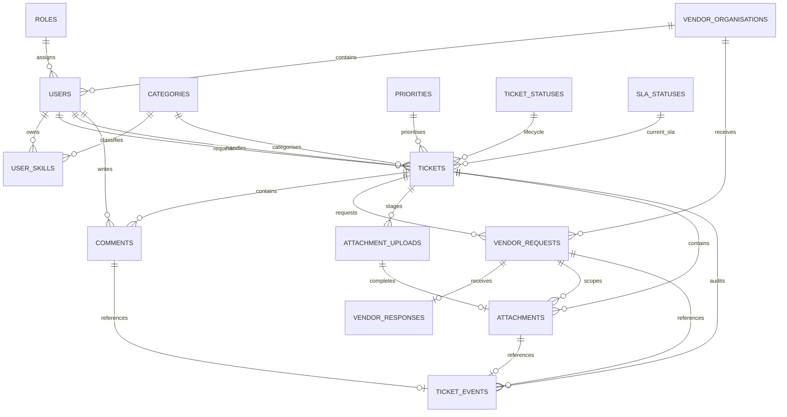

# IT Service Desk 数据库最终设计文档 v1.1

## 1. 文档定位

本文是 IT Service Desk 项目的 MySQL 最终数据库设计，作为 A、B、C 三名 Backend 成员建立 SQLAlchemy Model、编写 Repository、执行本地集成测试和最终部署 Amazon RDS 的共同依据。

本版本采用以下冻结决定：

- 本地开发和 AWS RDS 使用同一个 Database Name：`service_desk`。
- 所有环境使用完整的 19 张表，不再按成员只创建部分表。
- A、B、C 各自在自己的本地 MySQL 实例中建立完整且相互隔离的 `service_desk` Database。
- MySQL 版本为 8.0/8.4；最终目标为 Amazon RDS for MySQL 8.4。
- Character Set 为 `utf8mb4`，Collation 为 `utf8mb4_0900_ai_ci`，所有时间以 UTC 保存。
- 所有表使用 InnoDB，以支持 Transaction、Foreign Key 和 `SELECT ... FOR UPDATE`。
- 不使用 Alembic；`backend/database/schema.sql` 是唯一可执行 Schema Contract，本地和 RDS Empty Database 都执行同一文件。
- SQLAlchemy Models 是 Application Mapping，必须逐字段匹配 Canonical SQL；不得使用 `Base.metadata.create_all()` 生成另一套结构。
- 配套 Canonical SQL 内容冻结自 `IT-Service-Desk-MySQL-Schema-v1.0.sql`。本 v1.1 只修正文档优先级和初始化规则，不改变已经通过 MySQL 8.4 验证的 DDL。

> 本设计取代旧文档中 `service_desk_dev` 与 `service_desk_final` 两个 Database Name 的区分。环境隔离由不同 MySQL Instance/Endpoint、Credential 和 S3 Prefix 实现，不再依靠 Database Name 区分。出现字段或初始化冲突时，`IT-Service-Desk-Unified-Project-Baseline-v6.0.md` 决定流程和 Owner，Canonical SQL 决定可执行结构，本文负责解释字段和关系。

## 2. 设计目标

数据库需要支持以下业务能力：

1. 五类系统角色、用户登录资料、工程师可用状态和分类技能。
2. Ticket 的创建、自动分配、手工分配、Tier 2 升级和 Role-aware 查询。
3. 48 小时 Engineering SLA、80% AT_RISK、OVERDUE、120 小时 User Timer 和 7 天关闭窗口。
4. 普通 Comment 与 Workflow Comment 分离。
5. Tier 2 与 External Vendor 的隔离协作，每张 Ticket 同时最多一个 ACTIVE Vendor Request。
6. Browser 直传 Private S3 所需的 AttachmentUpload Session，以及验证后的 Attachment Metadata。
7. 只追加、按 Role/Organisation 过滤的 TicketEvent Audit Timeline。
8. Dashboard、Overdue Current/History、Ticket List 和 Background Job 所需索引。
9. 通过 Foreign Key、Unique Key、CHECK Constraint 和 Trigger 阻止明显无效或冲突数据。

## 3. 数据库命名与环境使用

| 项目 | 统一规则 |
|---|---|
| Database Name | `service_desk` |
| 本地开发 | A、B、C 各自在自己的 MySQL Instance 中创建完整 `service_desk`。 |
| AWS Integration/Final | RDS 中创建完整 `service_desk`，结构与本地完全一致。 |
| Character Set | `utf8mb4` |
| Collation | `utf8mb4_0900_ai_ci` |
| Timezone | UTC；Application Connection 建立后设置 `time_zone='+00:00'`。 |
| Engine | InnoDB |
| ID | 业务主键使用 `BIGINT UNSIGNED AUTO_INCREMENT`；附件 UUID 使用 ASCII `CHAR(36)`。 |
| 删除策略 | 业务记录不做物理删除；用户、Vendor 等通过 `is_active` 停用。Foreign Key 默认 RESTRICT。 |
| Secret | JWT Secret、AWS Key、Database Password 不进入任何业务表或 Git。 |

开发阶段的正确使用方式：

```text
成员 A 本地 MySQL Instance ── service_desk（19 张完整表）
成员 B 本地 MySQL Instance ── service_desk（19 张完整表）
成员 C 本地 MySQL Instance ── service_desk（19 张完整表）
AWS RDS Instance          ── service_desk（19 张相同表）
```

每名成员可以只开发自己负责的 Domain，但不得只建立自己负责的表，因为 Foreign Key、API Integration Test、Workflow Transaction 和 OpenAPI Contract 都依赖完整结构。

## 4. 逻辑关系图



## 5. 表清单与 Owner

| # | Table | Owner/Coordinator | 作用 |
|---:|---|---|---|
| 1 | `schema_metadata` | B | 记录已安装 Schema Version。 |
| 2 | `roles` | B | 五类系统角色。 |
| 3 | `categories` | B | Ticket Category，同时作为 Engineer Skill Category。 |
| 4 | `priorities` | B | Ticket Priority。 |
| 5 | `ticket_statuses` | B/C Review | Ticket 生命周期状态。 |
| 6 | `sla_statuses` | C | 当前 Engineering SLA 状态。 |
| 7 | `service_config` | B 协调，A/C Review | SLA、Timer 和 Attachment 限制。 |
| 8 | `allowed_attachment_types` | A | 允许的 Extension/MIME 组合。 |
| 9 | `vendor_organisations` | B | External Vendor Organisation Directory。 |
| 10 | `users` | B | 所有登录账号及 Role、Availability、Vendor Binding。 |
| 11 | `user_skills` | B/C Review | Engineer 与 Category 的多对多技能关系。 |
| 12 | `assignment_control` | C | Initial Auto Assignment 的 Singleton Lock Row。 |
| 13 | `tickets` | B 维护 Model，C 定义 Workflow | Ticket Core 和当前 Workflow/SLA Snapshot。 |
| 14 | `comments` | B | 普通和 Workflow Comment。 |
| 15 | `vendor_requests` | C | Tier 2 发给 Vendor 的脱敏请求。 |
| 16 | `vendor_responses` | C | Vendor 的正式回复。 |
| 17 | `attachment_uploads` | A | Presign 到 Complete 之间的 Upload Session。 |
| 18 | `attachments` | A | 已验证 S3 Object 的 Metadata。 |
| 19 | `ticket_events` | C | Append-only Audit Timeline 和 SLA History。 |

## 6. 完整字段字典

字段表中的 PK、FK、UQ、IDX 分别表示 Primary Key、Foreign Key、Unique Key 和普通 Index。`NULL=是` 表示该字段在合法业务状态下可以没有值。

### 6.1 `schema_metadata`

用途：确认 Database 已安装的逻辑名称和 Schema Version；只允许 `schema_id=1` 一行。

| 字段 | MySQL 类型 | NULL | Default/Key | 具体作用 |
|---|---|---:|---|---|
| `schema_id` | `TINYINT UNSIGNED` | 否 | PK，Default 1 | Singleton ID；CHECK 必须等于 1。 |
| `schema_name` | `VARCHAR(100)` | 否 |  | 逻辑系统名称。 |
| `schema_version` | `VARCHAR(20)` | 否 |  | 当前冻结结构版本，例如 `1.0`。 |
| `installed_at` | `DATETIME(6)` | 否 | Current UTC | 首次安装时间。 |
| `updated_at` | `DATETIME(6)` | 否 | Auto update | Schema Version 记录更新时间。 |

### 6.2 `roles`

用途：保存 API `Role` Enum 对应的五类角色，供 `users.role_code` 引用。

| 字段 | MySQL 类型 | NULL | Default/Key | 具体作用 |
|---|---|---:|---|---|
| `role_code` | `VARCHAR(32)` | 否 | PK | `USER`、`ENGINEER_TIER1`、`ENGINEER_TIER2`、`EXTERNAL_VENDOR`、`SERVICE_DESK_MANAGER`。 |
| `display_name` | `VARCHAR(100)` | 否 |  | 页面显示名称。 |
| `description` | `VARCHAR(500)` | 是 |  | 角色说明。 |
| `is_active` | `TINYINT(1)` | 否 | Default 1 | 是否允许继续使用该角色。 |
| `created_at` | `DATETIME(6)` | 否 | Current UTC | 创建时间。 |

### 6.3 `categories`

用途：Ticket Category 和 Engineer Skill 使用同一组稳定代码。

| 字段 | MySQL 类型 | NULL | Default/Key | 具体作用 |
|---|---|---:|---|---|
| `category_code` | `VARCHAR(32)` | 否 | PK | `NETWORK`、`HARDWARE`、`SOFTWARE`、`ACCOUNT`、`OTHER`。 |
| `display_name` | `VARCHAR(100)` | 否 |  | 页面显示名称。 |
| `description` | `VARCHAR(500)` | 是 |  | 类别解释。 |
| `sort_order` | `SMALLINT UNSIGNED` | 否 | Default 0 | API-12 和下拉列表排序。 |
| `is_active` | `TINYINT(1)` | 否 | Default 1 | 是否允许新 Ticket/Skill 使用。 |
| `created_at` | `DATETIME(6)` | 否 | Current UTC | 创建时间。 |

### 6.4 `priorities`

用途：保存 Ticket Priority Reference Data。

| 字段 | MySQL 类型 | NULL | Default/Key | 具体作用 |
|---|---|---:|---|---|
| `priority_code` | `VARCHAR(16)` | 否 | PK | `LOW`、`MEDIUM`、`HIGH`、`URGENT`。 |
| `display_name` | `VARCHAR(100)` | 否 |  | 页面显示名称。 |
| `description` | `VARCHAR(500)` | 是 |  | 业务影响说明。 |
| `sort_order` | `SMALLINT UNSIGNED` | 否 | Default 0 | 显示排序。 |
| `is_active` | `TINYINT(1)` | 否 | Default 1 | 是否允许选择。 |
| `created_at` | `DATETIME(6)` | 否 | Current UTC | 创建时间。 |

### 6.5 `ticket_statuses`

用途：保存 Ticket 的内部生命周期状态。`NEW` 只在 API-15 创建 Transaction 中短暂存在，不返回 Frontend。

| 字段 | MySQL 类型 | NULL | Default/Key | 具体作用 |
|---|---|---:|---|---|
| `status_code` | `VARCHAR(32)` | 否 | PK | NEW、UNASSIGNED、ASSIGNED、IN_PROGRESS、PENDING_USER、PENDING_VENDOR、RESOLVED、REOPENED、CLOSED。 |
| `display_name` | `VARCHAR(100)` | 否 |  | 内部显示名称。 |
| `description` | `VARCHAR(500)` | 是 |  | 状态说明。 |
| `sort_order` | `SMALLINT UNSIGNED` | 否 | Default 0 | 显示排序。 |
| `is_api_visible` | `TINYINT(1)` | 否 | Default 1 | `NEW=0`；其他状态为 1。Role-aware Serializer 仍可进一步隐藏 PENDING_VENDOR。 |

### 6.6 `sla_statuses`

用途：表示当前 Engineering SLA Cycle 的状态，而不是 Ticket 生命周期状态。

| 字段 | MySQL 类型 | NULL | Default/Key | 具体作用 |
|---|---|---:|---|---|
| `sla_status_code` | `VARCHAR(16)` | 否 | PK | ON_TRACK、AT_RISK、OVERDUE、PAUSED、MET。 |
| `display_name` | `VARCHAR(100)` | 否 |  | 页面显示名称。 |
| `description` | `VARCHAR(500)` | 是 |  | 状态解释。 |
| `sort_order` | `SMALLINT UNSIGNED` | 否 | Default 0 | 显示排序。 |

### 6.7 `service_config`

用途：保存 API-12、Workflow Service 和 Scheduled Task 共同使用的统一 Timer/Attachment 限制；只允许 `config_id=1` 一行。

| 字段 | MySQL 类型 | NULL | Default/Key | 具体作用 |
|---|---|---:|---|---|
| `config_id` | `TINYINT UNSIGNED` | 否 | PK，Default 1 | Singleton ID。 |
| `engineering_sla_hours` | `SMALLINT UNSIGNED` | 否 | Default 48 | 每个 Engineering Cycle 的小时数。 |
| `at_risk_percent` | `TINYINT UNSIGNED` | 否 | Default 80 | 写入 AT_RISK Event 的 Cycle 百分比。 |
| `user_response_hours` | `SMALLINT UNSIGNED` | 否 | Default 120 | INFORMATION_REQUIRED 和 RESOLUTION_CONFIRMATION 的回复窗口。 |
| `resolved_window_hours` | `SMALLINT UNSIGNED` | 否 | Default 168 | RESOLVED 后允许 Reopen/Manual Close 的 7 天窗口。 |
| `attachment_max_size_bytes` | `BIGINT UNSIGNED` | 否 | Default 10485760 | 单文件最大 10 MiB。 |
| `upload_url_ttl_seconds` | `INT UNSIGNED` | 否 | Default 900 | Presigned PUT 有效期 15 分钟。 |
| `download_url_ttl_seconds` | `INT UNSIGNED` | 否 | Default 300 | Presigned GET 有效期 5 分钟。 |
| `sla_monitor_interval_minutes` | `SMALLINT UNSIGNED` | 否 | Default 5 | SLA Monitor 建议运行间隔。 |
| `attachment_cleanup_interval_minutes` | `SMALLINT UNSIGNED` | 否 | Default 30 | Upload Session Cleanup 建议运行间隔。 |
| `updated_at` | `DATETIME(6)` | 否 | Auto update | 配置最后修改时间。 |

### 6.8 `allowed_attachment_types`

用途：定义 API-02 允许上传以及 API-12 返回的 Extension/MIME 组合。

| 字段 | MySQL 类型 | NULL | Default/Key | 具体作用 |
|---|---|---:|---|---|
| `extension` | `VARCHAR(16)` | 否 | PK | 小写且不带点，例如 `png`、`log`。 |
| `content_type` | `VARCHAR(100)` ASCII | 否 | IDX | 必须匹配的 MIME，例如 `image/png`。 |
| `description` | `VARCHAR(200)` | 是 |  | 文件类型说明。 |
| `is_active` | `TINYINT(1)` | 否 | Default 1 | 是否允许新上传。 |
| `created_at` | `DATETIME(6)` | 否 | Current UTC | 创建时间。 |

### 6.9 `vendor_organisations`

用途：API-14 的 Vendor Directory，以及 Vendor Scope 的组织边界。

| 字段 | MySQL 类型 | NULL | Default/Key | 具体作用 |
|---|---|---:|---|---|
| `vendor_org_id` | `BIGINT UNSIGNED` | 否 | PK, Auto Increment | Vendor Organisation ID。 |
| `name` | `VARCHAR(200)` | 否 | UQ | Organisation Name。 |
| `is_active` | `TINYINT(1)` | 否 | Default 1, IDX | 只有 Active Organisation 可以接收新请求。 |
| `created_at` | `DATETIME(6)` | 否 | Current UTC | 创建时间。 |
| `updated_at` | `DATETIME(6)` | 否 | Auto update | 更新时间。 |

### 6.10 `users`

用途：保存所有 Requester、Tier 1、Tier 2、Manager 和 Vendor 登录账号。

| 字段 | MySQL 类型 | NULL | Default/Key | 具体作用 |
|---|---|---:|---|---|
| `user_id` | `BIGINT UNSIGNED` | 否 | PK, Auto Increment | User ID。 |
| `email` | `VARCHAR(254)` | 否 | UQ | 规范化小写 Login Email。 |
| `password_hash` | `VARCHAR(255)` ASCII | 否 |  | Argon2/bcrypt 等强 Hash；永不通过 API 返回。 |
| `display_name` | `VARCHAR(100)` | 否 |  | 安全显示名。 |
| `role_code` | `VARCHAR(32)` | 否 | FK → roles, IDX | 当前授权角色。 |
| `is_available` | `TINYINT(1)` | 是 | IDX | Tier 1/Tier 2 必须为 0/1；其他角色必须为 NULL。 |
| `vendor_org_id` | `BIGINT UNSIGNED` | 是 | FK → vendor_organisations, IDX | Vendor 必须绑定 Organisation；其他角色必须为 NULL。 |
| `is_active` | `TINYINT(1)` | 否 | Default 1, IDX | 停用账号而不物理删除历史 Actor。 |
| `last_assigned_at` | `DATETIME(6)` | 是 | IDX | Initial Auto Assignment 的稳定排序字段。 |
| `created_at` | `DATETIME(6)` | 否 | Current UTC | 账号创建时间。 |
| `updated_at` | `DATETIME(6)` | 否 | Auto update | 资料更新时间。 |

重要约束：Engineer 必须具有 `is_available`；Vendor 必须具有 `vendor_org_id`；Email 必须以 `LOWER(TRIM(email))` 保存。

### 6.11 `user_skills`

用途：保存 Engineer 可以处理哪些 Category。Initial Assignment 和 API-13 都使用该表。

| 字段 | MySQL 类型 | NULL | Default/Key | 具体作用 |
|---|---|---:|---|---|
| `user_id` | `BIGINT UNSIGNED` | 否 | PK, FK → users | Engineer User ID。 |
| `category_code` | `VARCHAR(32)` | 否 | PK, FK → categories, IDX | Engineer Skill Category。 |
| `created_at` | `DATETIME(6)` | 否 | Current UTC | 技能关系创建时间。 |

Composite PK `(user_id, category_code)` 防止相同技能重复添加。Service 必须额外验证 User Role 是 Tier 1/Tier 2。

### 6.12 `assignment_control`

用途：API-15 Initial Auto Assignment 时执行 `SELECT ... FOR UPDATE` 的 Singleton Row，使多个并发 Ticket 依次计算 Active Load。

| 字段 | MySQL 类型 | NULL | Default/Key | 具体作用 |
|---|---|---:|---|---|
| `control_id` | `TINYINT UNSIGNED` | 否 | PK，Default 1 | Singleton ID，必须等于 1。 |
| `control_name` | `VARCHAR(50)` | 否 | UQ | 固定为 `INITIAL_ASSIGNMENT`。 |
| `updated_at` | `DATETIME(6)` | 否 | Auto update | 锁行记录更新时间；不保存业务状态。 |

### 6.13 `tickets`

用途：保存 Ticket Core 和“当前”Workflow/SLA Snapshot。历史 Cycle、历史 Assignment、历史 Resolution 和 Closure 证据保存在 `ticket_events`。

| 字段 | MySQL 类型 | NULL | Default/Key | 具体作用 |
|---|---|---:|---|---|
| `ticket_id` | `BIGINT UNSIGNED` | 否 | PK, Auto Increment | Ticket ID。 |
| `requester_id` | `BIGINT UNSIGNED` | 否 | FK → users, IDX | 创建 Ticket 的 USER。 |
| `title` | `VARCHAR(200)` | 否 |  | 标题，长度 1–200。 |
| `description` | `TEXT` | 否 |  | 用户原始描述，长度 1–5000；不向 Vendor 直接返回。 |
| `category_code` | `VARCHAR(32)` | 否 | FK → categories, IDX | Ticket Category。 |
| `priority_code` | `VARCHAR(16)` | 否 | FK → priorities, IDX | Ticket Priority。 |
| `status_code` | `VARCHAR(32)` | 否 | FK → ticket_statuses, Default NEW, IDX | 内部生命周期状态。 |
| `assignee_id` | `BIGINT UNSIGNED` | 是 | FK → users, IDX | 当前 Tier 1/Tier 2 Assignee。 |
| `last_resolved_assignee_id` | `BIGINT UNSIGNED` | 是 | FK → users | RESOLVED 时保存的 Assignee，供 Reopen 优先恢复。 |
| `sla_cycle_no` | `INT UNSIGNED` | 否 | Default 1 | 当前 Engineering Cycle Number。 |
| `sla_status_code` | `VARCHAR(16)` | 否 | FK → sla_statuses, Default ON_TRACK, IDX | 当前 SLA Status。 |
| `sla_started_at` | `DATETIME(6)` | 是 |  | 当前 Cycle 开始时间。 |
| `sla_deadline` | `DATETIME(6)` | 是 | IDX | 当前 Cycle Deadline。 |
| `pending_user_reason` | `VARCHAR(32)` | 是 |  | INFORMATION_REQUIRED 或 RESOLUTION_CONFIRMATION。 |
| `pending_user_deadline` | `DATETIME(6)` | 是 | IDX | User 120 小时回复截止时间。 |
| `resolution_summary` | `TEXT` | 是 |  | Engineer 提交的 User-visible 解决方案，最大 5000 字符。 |
| `resolution_type` | `VARCHAR(64)` | 是 |  | USER_CONFIRMED、AUTO_NO_USER_RESPONSE、AUTO_CONFIRMATION_TIMEOUT。 |
| `resolved_at` | `DATETIME(6)` | 是 |  | 正式进入 RESOLVED 的时间。 |
| `auto_close_at` | `DATETIME(6)` | 是 | IDX | `resolved_at + 168h`。 |
| `closure_type` | `VARCHAR(32)` | 是 |  | MANUAL_USER 或 AUTO_AFTER_7_DAYS。 |
| `closed_at` | `DATETIME(6)` | 是 |  | CLOSED 时间。 |
| `created_at` | `DATETIME(6)` | 否 | Current UTC, IDX | Ticket 创建时间。 |
| `updated_at` | `DATETIME(6)` | 否 | Auto update | 最后业务更新时间。 |

关键 CHECK：

- UNASSIGNED 必须 `assignee_id=NULL`；ASSIGNED/IN_PROGRESS/PENDING_USER/PENDING_VENDOR 必须有 Assignee。
- 只有 PENDING_USER 可以保存 `pending_user_reason/deadline`。
- RESOLUTION_CONFIRMATION 必须先有 `resolution_summary`，但尚未产生 `resolution_type/resolved_at`。
- RESOLVED/CLOSED 必须具有 Resolution Type、Resolved Time 和 Auto Close Time。
- CLOSED 必须具有 Closure Type 和 Closed Time；非 CLOSED 不允许保存 Closure 字段。

### 6.14 `comments`

用途：保存普通沟通以及 API-23/API-24 等 Workflow Service 创建的正式沟通文字。

| 字段 | MySQL 类型 | NULL | Default/Key | 具体作用 |
|---|---|---:|---|---|
| `comment_id` | `BIGINT UNSIGNED` | 否 | PK, Auto Increment | Comment ID。 |
| `ticket_id` | `BIGINT UNSIGNED` | 否 | FK → tickets, IDX | 所属 Ticket。 |
| `author_id` | `BIGINT UNSIGNED` | 否 | FK → users, IDX | 留言作者。 |
| `message` | `TEXT` | 否 |  | 内容，长度 1–4000。 |
| `visibility` | `VARCHAR(32)` | 否 |  | USER_VISIBLE 或 INTERNAL_ONLY。 |
| `comment_type` | `VARCHAR(16)` | 否 | Default ORDINARY | ORDINARY 或 WORKFLOW。 |
| `workflow_action` | `VARCHAR(64)` | 是 |  | WORKFLOW 时保存稳定 Action Name；ORDINARY 时必须为 NULL。 |
| `created_at` | `DATETIME(6)` | 否 | Current UTC, IDX | 创建时间。 |

注意：Comment 本身不自动改变 Ticket 状态。Workflow Service 必须在同一个 Transaction 中创建 Comment、更新 Ticket 并写 Event。

### 6.15 `vendor_requests`

用途：保存 Tier 2 明确编写的 Vendor-safe Request，不自动复制 User Description、Personal Data 或 Internal Comment。

| 字段 | MySQL 类型 | NULL | Default/Key | 具体作用 |
|---|---|---:|---|---|
| `vendor_request_id` | `BIGINT UNSIGNED` | 否 | PK, Auto Increment | Vendor Request ID。 |
| `ticket_id` | `BIGINT UNSIGNED` | 否 | FK → tickets, IDX | 所属 Ticket。 |
| `vendor_org_id` | `BIGINT UNSIGNED` | 否 | FK → vendor_organisations, IDX | 接收请求的 Organisation。 |
| `requested_by_id` | `BIGINT UNSIGNED` | 否 | FK → users | 创建请求的 Tier 2。 |
| `vendor_message` | `TEXT` | 否 |  | 脱敏信息，长度 1–4000。 |
| `status` | `VARCHAR(16)` | 否 | Default ACTIVE, IDX | ACTIVE、RESPONDED、CANCELLED。 |
| `responded_at` | `DATETIME(6)` | 是 |  | Vendor 正式回复时间。 |
| `cancelled_at` | `DATETIME(6)` | 是 |  | Tier 2 不等待 Vendor 而直接 Resolve 时的取消时间。 |
| `cancelled_by_id` | `BIGINT UNSIGNED` | 是 | FK → users | 执行取消的 Tier 2。 |
| `cancellation_reason` | `VARCHAR(1000)` | 是 |  | 取消原因。 |
| `created_at` | `DATETIME(6)` | 否 | Current UTC, IDX | 创建时间。 |
| `updated_at` | `DATETIME(6)` | 否 | Auto update | 状态更新时间。 |
| `active_ticket_guard` | Generated `BIGINT` | 是 | UQ | ACTIVE 时等于 ticket_id，否则 NULL；保证每 Ticket 同时最多一个 ACTIVE Request。 |

### 6.16 `vendor_responses`

用途：保存 Vendor 针对当前 Active Request 提交的一次正式回复。

| 字段 | MySQL 类型 | NULL | Default/Key | 具体作用 |
|---|---|---:|---|---|
| `vendor_response_id` | `BIGINT UNSIGNED` | 否 | PK, Auto Increment | Vendor Response ID。 |
| `vendor_request_id` | `BIGINT UNSIGNED` | 否 | FK → vendor_requests, UQ | 每个 Request 最多一个正式 Response。 |
| `responder_id` | `BIGINT UNSIGNED` | 否 | FK → users, IDX | 提交回复的 Vendor User。 |
| `message` | `TEXT` | 否 |  | 回复内容，长度 1–4000。 |
| `created_at` | `DATETIME(6)` | 否 | Current UTC | 回复时间。 |

Service 仍必须验证 `responder.vendor_org_id = vendor_request.vendor_org_id`，因为普通 Foreign Key 无法表达跨表角色和 Organisation 一致性。

### 6.17 `attachment_uploads`

用途：保存 API-02 Presign 与 API-03 Complete 之间的可信 Upload Session。Browser PUT 成功不等于 Attachment 已正式登记。

| 字段 | MySQL 类型 | NULL | Default/Key | 具体作用 |
|---|---|---:|---|---|
| `upload_id` | ASCII `CHAR(36)` | 否 | PK | Backend 生成的 UUID，API-03 唯一输入。 |
| `ticket_id` | `BIGINT UNSIGNED` | 否 | FK → tickets, IDX | 固定绑定 Ticket。 |
| `creator_id` | `BIGINT UNSIGNED` | 否 | FK → users, IDX | Presign 发起人；只有该 Actor 可以 Complete。 |
| `object_key` | ASCII `VARCHAR(1024)` | 否 | UQ | Backend 生成的 Private S3 Object Key。 |
| `file_name` | `VARCHAR(255)` | 否 |  | 原始显示文件名。 |
| `expected_content_type` | ASCII `VARCHAR(100)` | 否 |  | API-02 已验证的 MIME。 |
| `expected_size` | `BIGINT UNSIGNED` | 否 |  | API-02 已验证的文件大小，1–10 MiB。 |
| `visibility` | `VARCHAR(32)` | 否 |  | USER_VISIBLE、INTERNAL_ONLY、VENDOR_SHARED。 |
| `vendor_request_id` | `BIGINT UNSIGNED` | 是 | FK → vendor_requests, IDX | VENDOR_SHARED 必须绑定当前 Active Request。 |
| `vendor_org_id` | `BIGINT UNSIGNED` | 是 | FK → vendor_organisations, IDX | VENDOR_SHARED 的 Organisation Scope。 |
| `status` | `VARCHAR(16)` | 否 | Default PENDING, IDX | PENDING、COMPLETED、EXPIRED、ABORTED。 |
| `expires_at` | `DATETIME(6)` | 否 | IDX | Presigned PUT 过期时间。 |
| `completed_at` | `DATETIME(6)` | 是 |  | Complete 成功时间。 |
| `expired_at` | `DATETIME(6)` | 是 |  | Cleanup 标记 EXPIRED 的时间。 |
| `aborted_at` | `DATETIME(6)` | 是 |  | Integrity Mismatch 或 Ticket Close 后终止时间。 |
| `attachment_id` | ASCII `CHAR(36)` | 是 | UQ, FK → attachments | COMPLETED 后绑定正式 Attachment。 |
| `created_at` | `DATETIME(6)` | 否 | Current UTC | Session 创建时间。 |
| `updated_at` | `DATETIME(6)` | 否 | Auto update | 状态更新时间。 |

关键约束：VENDOR_SHARED 必须同时具有 Vendor Request 和 Organisation；其他 Visibility 两者必须为 NULL。只有 COMPLETED 可以具有 `attachment_id/completed_at`。

### 6.18 `attachments`

用途：保存经过 S3 HeadObject 验证后的永久 Metadata；文件字节只保存在 Private S3。

| 字段 | MySQL 类型 | NULL | Default/Key | 具体作用 |
|---|---|---:|---|---|
| `attachment_id` | ASCII `CHAR(36)` | 否 | PK | Attachment UUID。 |
| `upload_id` | ASCII `CHAR(36)` | 否 | FK → attachment_uploads, UQ | 每个 Upload Session 最多生成一个 Attachment。 |
| `ticket_id` | `BIGINT UNSIGNED` | 否 | FK → tickets, IDX | 所属 Ticket。 |
| `creator_id` | `BIGINT UNSIGNED` | 否 | FK → users | 上传者。 |
| `object_key` | ASCII `VARCHAR(1024)` | 否 | UQ | Private S3 Object Key；API 不返回。 |
| `file_name` | `VARCHAR(255)` | 否 |  | 用户看到的文件名。 |
| `verified_content_type` | ASCII `VARCHAR(100)` | 否 |  | 来自 HeadObject 的 MIME。 |
| `verified_size` | `BIGINT UNSIGNED` | 否 |  | 来自 HeadObject 的大小，1–10 MiB。 |
| `visibility` | `VARCHAR(32)` | 否 | IDX | USER_VISIBLE、INTERNAL_ONLY、VENDOR_SHARED。 |
| `vendor_request_id` | `BIGINT UNSIGNED` | 是 | FK → vendor_requests, IDX | VENDOR_SHARED 历史 Scope。 |
| `vendor_org_id` | `BIGINT UNSIGNED` | 是 | FK → vendor_organisations, IDX | Vendor Organisation Scope。 |
| `created_at` | `DATETIME(6)` | 否 | Current UTC, IDX | 正式登记时间。 |

`attachment_uploads.attachment_id` 与 `attachments.upload_id` 构成双向一对一关系；API-03 必须在同一 Transaction 中创建 Attachment、更新 Session 并写 Event。

### 6.19 `ticket_events`

用途：保存从 Ticket 创建到关闭的 Append-only Audit Timeline，支持 API-07 History、API-32、SLA Evidence 和并发 Job 幂等。

| 字段 | MySQL 类型 | NULL | Default/Key | 具体作用 |
|---|---|---:|---|---|
| `event_id` | `BIGINT UNSIGNED` | 否 | PK, Auto Increment | Event ID。 |
| `ticket_id` | `BIGINT UNSIGNED` | 否 | FK → tickets, IDX | 所属 Ticket。 |
| `event_type` | `VARCHAR(64)` | 否 | IDX, CHECK | 稳定 EventType，共 24 种。 |
| `scope` | `VARCHAR(32)` | 否 | IDX | USER_VISIBLE、INTERNAL_ONLY、VENDOR_SCOPE。 |
| `actor_id` | `BIGINT UNSIGNED` | 是 | FK → users | 执行人；System Event 为 NULL。 |
| `vendor_org_id` | `BIGINT UNSIGNED` | 是 | FK → vendor_organisations, IDX | VENDOR_SCOPE 必须绑定 Organisation。 |
| `cycle_no` | `INT UNSIGNED` | 是 |  | 对应 Engineering Cycle。 |
| `comment_id` | `BIGINT UNSIGNED` | 是 | FK → comments, UQ | COMMENT_ADDED Event 引用 Comment，不复制正文。 |
| `attachment_id` | ASCII `CHAR(36)` | 是 | FK → attachments, UQ | ATTACHMENT_ADDED Event 引用 Attachment。 |
| `vendor_request_id` | `BIGINT UNSIGNED` | 是 | FK → vendor_requests, IDX | Vendor Workflow Event 的 Request Reference。 |
| `metadata` | `JSON` | 否 | Default `{}` | 最小非敏感 Metadata；不得复制完整 Comment、Vendor Payload 或 Secret。 |
| `occurred_at` | `DATETIME(6)` | 否 | Current UTC, IDX | Event 发生时间。 |
| `cycle_guard_ticket_id` | Generated `BIGINT` | 是 | UQ 组成部分 | 仅 Cycle Guard Event 生成 ticket_id。 |
| `cycle_guard_cycle_no` | Generated `INT` | 是 | UQ 组成部分 | 仅 Cycle Guard Event 生成 cycle_no。 |
| `cycle_guard_event_type` | Generated `VARCHAR(64)` | 是 | UQ 组成部分 | 仅 SLA_CYCLE_STARTED/PAUSED/AT_RISK/OVERDUE/MET 生成 Event Type。 |

Generated Guard 的 Unique Key `(ticket_id, cycle_no, event_type)` 保证 SLA Job 重跑不会为同一 Cycle 重复写入同一种 SLA Event。两个 Trigger 禁止 UPDATE 和 DELETE，保证 Event 只追加。

## 7. 关键关系与删除策略

| Parent | Child | 关系 | 删除策略/原因 |
|---|---|---|---|
| roles | users | 1:N | RESTRICT；角色被历史账号引用时不能删除。 |
| vendor_organisations | users/vendor_requests/attachments/events | 1:N | RESTRICT；通过 `is_active=0` 停用。 |
| users | tickets/comments/vendor/attachments/events | 1:N | RESTRICT；账号停用而不物理删除，保留审计 Actor。 |
| tickets | comments/vendor_requests/uploads/attachments/events | 1:N | RESTRICT；Ticket 不物理删除。 |
| vendor_requests | vendor_responses | 1:0..1 | Unique `vendor_request_id`。 |
| vendor_requests | attachment_uploads/attachments/events | 1:N | 保留 Vendor 历史 Scope。 |
| attachment_uploads | attachments | 1:0..1 | 双向唯一引用，支持 API-03 幂等。 |
| comments | ticket_events | 1:0..1 | COMMENT_ADDED Event 只引用 `comment_id`。 |
| attachments | ticket_events | 1:0..1 | ATTACHMENT_ADDED Event 只引用 `attachment_id`。 |

## 8. 不能只依靠数据库约束的规则

下列规则涉及跨表、当前登录 Actor、时间边界或状态机，必须由 Backend Service/Policy 在锁行后的 Transaction 中实现：

1. Requester 必须是 `role_code=USER`。
2. Assignee 必须是 Active、Available、Skill 匹配的 Tier 1/Tier 2。
3. `user_skills` 只能分配给 Engineer。
4. Initial Assignment 必须先锁定 `assignment_control` Row，再计算 Active Load。
5. Manager Assign/Reassign 必须遵守状态矩阵，不能在任意状态换人。
6. Vendor Response Actor 的 `vendor_org_id` 必须与 Active Vendor Request 一致。
7. VENDOR_SHARED Attachment 必须绑定当前 Active Vendor Request；历史 Request 只能读取不能新增。
8. API-03 必须用 S3 HeadObject 核对 Size/Content-Type，并验证 Complete Actor 是 Presign Creator。
9. `now >= deadline` 时必须先执行自动结果，再拒绝已经过期的 User Action。
10. 普通 Comment 不得触发 Resume、Confirm Resolution 或 Vendor Response。
11. CLOSED 禁止所有业务写操作，但允许已有授权数据继续读取。
12. TicketEvent、业务对象和状态变化必须在同一个 Transaction 中提交。

## 9. 索引设计与主要查询

| 使用场景/API | 主要索引 |
|---|---|
| API-13 Initial Assignment Candidate | `users(role_code,is_active,is_available,last_assigned_at,user_id)`、`user_skills(category_code,user_id)` |
| API-16 Requester My Tickets | `tickets(requester_id,created_at,ticket_id)` |
| API-16 Engineer Queue | `tickets(assignee_id,status_code,sla_status_code,sla_deadline,ticket_id)` |
| API-16 Manager Filters | `tickets(status_code,category_code,priority_code,created_at,ticket_id)` |
| API-06 Dashboard / SLA Job | `tickets(sla_status_code,sla_deadline,status_code,ticket_id)` |
| Pending User Auto Result | `tickets(status_code,pending_user_deadline,ticket_id)` |
| Seven-day Auto Close | `tickets(status_code,auto_close_at,ticket_id)` |
| Vendor Ticket Scope | `vendor_requests(vendor_org_id,status,created_at,vendor_request_id)` |
| Upload Cleanup | `attachment_uploads(status,expires_at,upload_id)` |
| Attachment List | `attachments(ticket_id,visibility,created_at,attachment_id)` |
| API-32 Timeline | `ticket_events(ticket_id,scope,occurred_at,event_id)` |
| API-07 Overdue History | `ticket_events(event_type,occurred_at,event_id)` |

`description`、Comment Message 和 Vendor Message 不建立 Full-text Index；MVP 的 `search` 先限制在 Ticket ID/Title 或使用受控查询，避免无经验团队过早引入复杂搜索和额外资源。

## 10. Database 与 32 个 API 的映射

| API | 主要读取表 | 主要写入表 |
|---:|---|---|
| 01 | schema_metadata 或 `SELECT 1` | 无 |
| 02 | tickets、vendor_requests、service_config、allowed_attachment_types | attachment_uploads |
| 03 | tickets、attachment_uploads | attachments、attachment_uploads、ticket_events |
| 04–05 | tickets、attachments、vendor_requests | 无 |
| 06 | tickets、users | 无 |
| 07 | tickets、ticket_events、users | 无 |
| 08 | roles | users |
| 09 | users | 无 |
| 10–11 | users、vendor_organisations | users（仅 API-11） |
| 12 | categories、priorities、ticket_statuses、service_config、allowed_attachment_types | 无 |
| 13 | users、user_skills、categories、tickets | 无 |
| 14 | vendor_organisations | 无 |
| 15 | assignment_control、users、user_skills、tickets | tickets、users、ticket_events |
| 16–18 | tickets、users、user_skills | tickets（仅 API-18）、ticket_events（API-18 审计） |
| 19–20 | tickets、comments、users | comments、ticket_events（仅 API-20） |
| 21–25 | tickets、users、user_skills、comments | tickets、comments（23/24）、ticket_events |
| 26 | tickets、vendor_organisations、vendor_requests | tickets、vendor_requests、ticket_events |
| 27 | tickets、vendor_requests、users | tickets、vendor_requests、vendor_responses、ticket_events |
| 28–31 | tickets、vendor_requests | tickets、vendor_requests（需要取消时）、ticket_events |
| 32 | tickets、ticket_events、users | 无 |

## 11. Transaction 和锁顺序

为减少 Deadlock，所有写操作使用统一顺序：

```text
BEGIN
  1. SELECT Ticket ... FOR UPDATE
  2. 如需要，再锁 VendorRequest 或 AttachmentUpload
  3. 重新验证 Actor、Scope、Status、Deadline 和 Binding
  4. 更新业务对象
  5. INSERT TicketEvent
COMMIT
```

API-15 Initial Assignment 的顺序为：

```text
BEGIN
  1. SELECT assignment_control WHERE control_id=1 FOR UPDATE
  2. 计算合格 Tier 1 Candidate 和 Active Load
  3. INSERT/UPDATE Ticket 与 Assignee last_assigned_at
  4. INSERT TicketEvent
COMMIT
```

失败请求整体 Rollback，不写“失败 Event”。

## 12. 初始化、验证与协作流程

### 12.1 本地开发

1. 每位 Backend 成员安装 MySQL 8.0/8.4，并使用自己的本地账号。
2. 把经过 Review 的 `IT-Service-Desk-MySQL-Schema-v1.0.sql` 放入 Repository 的 `backend/database/schema.sql`，在空实例执行该 Canonical 文件，创建完整 `service_desk`。
3. Backend `.env` 只保存本人的 Connection String，不提交 Git。
4. A/B/C 使用相同 SQLAlchemy Model Registry；不得只导入自己的 Domain Model；Model 必须通过 CI Schema Drift Test 与 Canonical SQL 比较。
5. 修改结构时，Domain Owner 先修改 Model 和本设计，B Review 外键、索引和空库创建结果。
6. Feature 阶段允许重建自己的本地空库，但不得把个人 SQL Dump 合并成 Final Schema。

### 12.2 AWS RDS

1. 创建 Empty Private RDS MySQL 8.4 Instance。
2. 使用 One-off Bootstrap Task 在 RDS 创建同名 `service_desk` 和完整结构。
3. 执行非敏感 Reference Seed；不要执行 Demo User Seed。
4. 运行 Schema Verification：表数量、Foreign Key、Unique Key、Index、CHECK 和 Trigger。
5. Backend Smoke Test 通过后，再开始 Frontend Cloud Integration。

### 12.3 预期验证结果

- 19 张 Base Table，全部为 InnoDB。
- 35 个 Foreign Key。
- 关键 Unique Guard 包含：Email、Vendor Name、User Skill、One Active Vendor Request、One Vendor Response、Upload/Object/Attachment 和 SLA Cycle Event。
- `ticket_events` 存在禁止 UPDATE/DELETE 的两个 Trigger。
- Database 中不存在 Demo Account、明文密码、AWS Credential 或 JWT Secret。

## 13. Canonical SQL 与 SQLAlchemy Model 的对应要求

Canonical SQL 是唯一可执行结构来源；本文是字段说明；SQLAlchemy Model 是 Backend 访问该结构的映射。实际 Backend 必须建立与 SQL 完全一致的 Model：

- Column Name、Type、Nullable、Default 必须一致。
- Relationship 不得通过 ORM Cascade 删除历史记录。
- Enum/Reference Code 必须与 API OpenAPI Enum 一致。
- `model_registry.py` 必须导入 19 张表对应的全部 Model。
- `bootstrap.py` 必须对 Empty Database 应用 Canonical SQL，禁止通过 `Base.metadata.create_all()` 建立另一套结构。
- CI 必须在新的空 MySQL Database 中执行完整 Bootstrap、Constraint Test 和 SQLAlchemy Metadata/Information Schema Drift Comparison。
- 运行中 FastAPI OpenAPI 与数据库字段的区别要保持清晰：Database 可保存 Password Hash、Object Key 等内部字段，但 Response Model 不得返回这些字段。

## 14. Schema Freeze 规则

本 v1.1 作为首次开发的完整结构说明；实际 DDL 仍为已通过 MySQL 8.4 验证的 Schema v1.0。Schema Freeze 后若确实需要修改：

1. Domain Owner 创建独立 Trello Card 和短期 Branch。
2. 说明受影响 Table、API、Pydantic Model、Test 和回滚方式。
3. 至少由 B（Database Schema Coordinator）和一名相关 Domain Owner Review。
4. Final RDS 已有数据时必须先 Snapshot，再执行版本化 SQL Patch。
5. 禁止在 MySQL Workbench 中手工修改 Final RDS 来绕过 Review。
